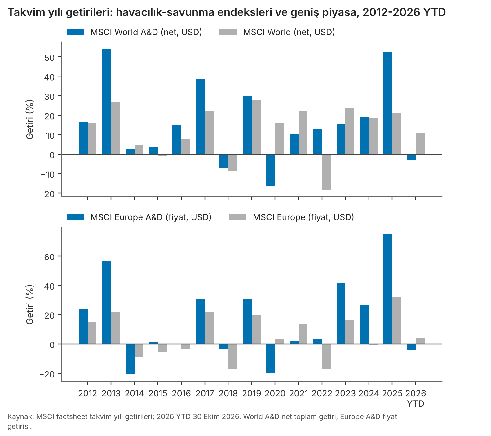
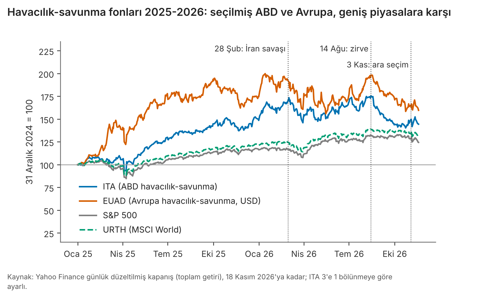
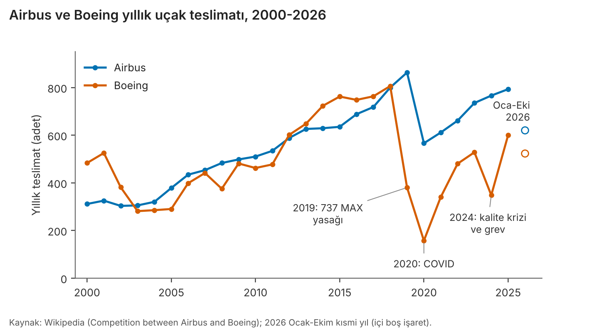
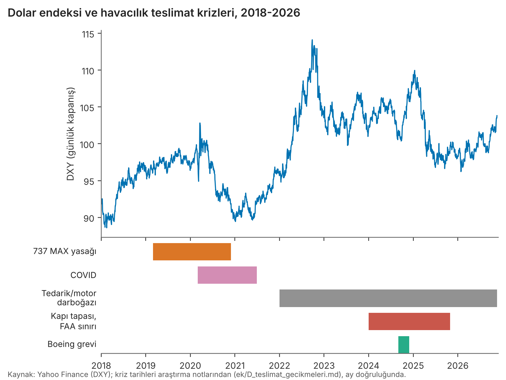
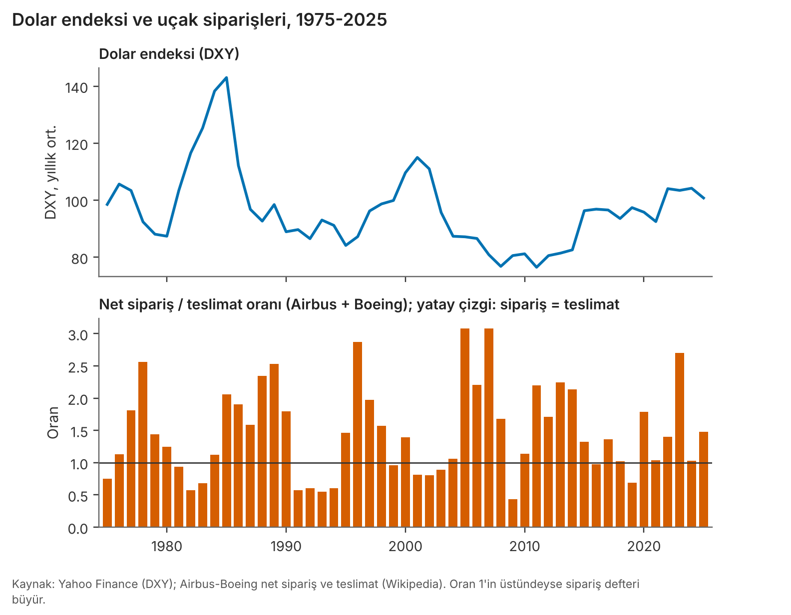

Araştırma raporu · 19 Kasım 2026

# Havacılık-Savunma Endeksleri ve Dolar: Borsa Görünümü ve Teslimat Gecikmeleri

Kapsam: MSCI World, MSCI Europe ve Dow Jones US Aerospace &amp; Defense endeksleri; dolar endeksi (DXY) ile uçak üretimi ve teslimat gecikmeleri. Veri kesimi: MSCI bilgi föyleri 30 Ekim 2026, fiyat verisi 18 Kasım 2026.

## Kısa yanıt

1. **Üç endeks 2025'te çok sert yükseldi, 2026'da geniş piyasanın gerisinde kaldı.** 2025: MSCI World A&D +%52,5, MSCI Europe A&D +%74,8 (dolar bazında), ABD seçilmiş A&D +%48,6. 2026'da yıl başından beri eksi %2-4; geniş piyasa artı %7-11.
2. **2026'daki zayıflık talep çöküşü değil.** Sipariş birikimleri rekor düzeyde. Basının gösterdiği nedenler: yüksek değerleme, teslim hayal kırıklıkları (Boeing, Rheinmetall), ABD bütçe siyaseti ve ateşkes haberleri.
3. **Sivil havacılıkta talep güçlü, havayolu kârı zayıf.** IATA 2026 kâr öngörüsünü 41 milyar dolardan 23 milyar dolara indirdi; üretim darboğazı sürüyor.
4. **Dolar teslimat gecikmelerinin nedeni değil.** Gecikmeler arz kaynaklı (motor, tedarik zinciri, kalite, sertifikasyon). İncelenen kaynaklar kuru neden saymıyor; testlerimizde dolar ile teslimat ve üretim arasındaki ilişki sağlam çıkmadı.
5. **Doların sağlam göründüğü yer siparişler.** Geçmiş veride dolar güçlendikten sonraki 0-3 yılda yeni siparişler azalma eğiliminde (ilişki; nedensellik kanıtı değil). Kuyruğu uzatan çoğunlukla zayıf dolar dönemleri; güçlü dolar gecikme üretmiyor.
6. **Dolar kârı ve getirinin para birimini etkiliyor.** Avrupa endeksinin 2026 getirisi dolar bazında −%4,2, avro bazında +%0,8.

## Ne yapmalıyım

1. **Endeksleri karşılaştırırken para birimini ve getiri türünü eşitle.** Aynı endeks dolar ve avro bazında farklı sonuç veriyor; "net" getiri temettüyü içerir, "fiyat" getirisi içermez.
2. **Teslimat gecikmesini izlemek için dolara değil üretim verisine bak:** Airbus ve Boeing aylık teslimatları, motor teslimatları (CFM LEAP, Pratt & Whitney GTF), Boeing 737 üretim hızı (hedef ayda 47), 777X sertifikasyonu, IATA sipariş birikimi ve filo yaşı.
3. **Doları iki yerde izle:** (a) yeni sipariş temposu ve ABD dışı havayollarının ödeme gücü, 1-3 yıl gecikmeli; (b) Avrupalı üreticilerin kârı. Airbus'ın kur koruma ortalaması 1,22; kur 1,10 civarında kaldıkça yeni korumalar daha iyi düzeyden yapılır (yorum).
4. **Yakın takvim:** ABD 2027 savunma bütçesi (geçici bütçe 11 Aralık'ta doluyor; 350 milyar dolarlık ek paket onaysız), Airbus yıl sonu teslimat sayısı (Ocak başı), dördüncü çeyrek bilançoları (Ocak sonu), İran ateşkesinin akıbeti.
5. **Değerlemeyi çıpa al.** Sektör fiyat/kazanç oranı geniş piyasanın yaklaşık 1,5 katı. Rekor sipariş birikimi tek başına getiri sağlamıyor; Rheinmetall bunun örneği.
6. Bu rapor yatırım tavsiyesi değildir. İstatistik bulguları ilişkidir, nedensellik kanıtı değildir.

## Bölüm 1 — Borsa analizi

### 1.1 Üç endeks neyi ölçüyor

| Endeks | Bileşen | En büyük ağırlıklar (%) | Yoğunlaşma |
|---|---:|---|---|
| MSCI World A&D (gelişmiş ülkeler; ABD %67,3, Fransa %12,4, Birleşik Krallık %10,7, Almanya %3,8) | 36 | GE Aerospace 14,8; RTX 12,7; Rolls-Royce 6,5; Lockheed Martin 6,2; Boeing 6,1; Airbus 6,0 | İlk 10 = %68,8 |
| MSCI Europe A&D | 13 | Rolls-Royce 21,9; Airbus 20,2; Safran 16,8; BAE Systems 12,8; Rheinmetall 8,6 | İlk 5 = %80,2 |
| Dow Jones US Select A&D (ITA fonu üzerinden) | 50 | GE Aerospace 21,7; RTX 17,1; Boeing 6,5; Lockheed Martin 5,3; Northrop Grumman 5,0 | İlk 2 = %38,9 |

*MSCI: 30 Ekim 2026 bilgi föyleri. ITA: iShares, 17 Kasım 2026.*

Üç endeks de az sayıda şirkete dayanıyor; birkaç hissenin hareketi endeksi belirliyor. **Düzeltme:** Sorudaki "Dow Jones US Aerospace & Defense Index"in kendi verisine erişilemedi (S&P sitesi kapalı). Onun "Select" sürümünü izleyen ITA fonunu vekil olarak kullandım. İki sürümün tanım farkı doğrulanamadı.

### 1.2 Getiri, değerleme ve risk

| Dönem (%) | World A&D (net, USD) | MSCI World (net, USD) | Europe A&D (fiyat, USD) | MSCI Europe (fiyat, USD) | Europe A&D (fiyat, EUR) | ITA (toplam, USD) | S&P 500 (fiyat) |
|---|---:|---:|---:|---:|---:|---:|---:|
| 2025 | +52,5 | +21,1 | +74,8 | +32,0 | +54,1 | +48,6 | +16,4 |
| 2026, 30 Ekim'e kadar | −2,9 | +10,9 | −4,2 | +4,1 | +0,8 | −2,1 | +10,7 |
| Son 3 ay | −11,5 | +0,6 | −10,5 | — | −7,8 | −11,8 | +1,9 |
| Son 1 yıl | −3,3 | +12,1 | −7,4 | +9,5 | −4,3 | −2,3 | +11,1 |
| 3 yıl (yıllık) | +26,1 | +22,3 | +34,6 | +16,2 | +32,2 | +25,8 | +22,1 |
| 5 yıl (yıllık) | +17,9 | +10,5 | +24,4 | +5,8 | +25,3 | +15,9 | +10,5 |
| 10 yıl (yıllık) | +14,2 | +13,0 | +16,1 | +6,8 | +15,9 | +13,5 | +13,6 |

*MSCI sütunları bilgi föylerinden (30 Ekim 2026). ITA ve S&P 500 fiyat verisinden hesaplandı. Sütunlar getiri türü ve para birimi bakımından aynı değildir; yalnızca komşu çiftler doğrudan karşılaştırılabilir.*

| Değerleme (30 Ekim 2026) | F/K | İleriye dönük F/K | PD/DD | Temettü verimi |
|---|---:|---:|---:|---:|
| MSCI World A&D | 33,9 | 25,3 | 8,1 | %1,3 |
| MSCI World | 22,3 | 17,4 | 4,1 | %1,5 |
| MSCI Europe A&D | 29,2 | 22,3 | 7,3 | %1,3 |
| MSCI Europe | 16,8 | 14,1 | 2,5 | %2,9 |

*F/K: fiyat/kazanç oranı. PD/DD: piyasa değeri/defter değeri.*

Okuma:

- **Uzun vadede sektör piyasayı geçti**, en belirgin biçimde Avrupa'da: 5 yılda yıllık %24'e karşı %6.
- **2026 bir geri verme yılı.** 30 Ekim itibarıyla üç endeks de son üç ayda %10-12 düştü; geniş piyasa yatay kaldı.
- **Kur etkisi büyük.** Avrupa endeksi 2025'te dolar bazında +%74,8, avro bazında +%54,1 kazandı; fark avronun değerlenmesinden. 2026'da dolar güçlendi ve tablo tersine döndü.
- **Değerleme pahalı.** Sektörün F/K'sı geniş piyasanın yaklaşık 1,5 katı (dünya), Avrupa'da 1,7 katı.
- **Risk yüksek.** Üç yıllık oynaklık World A&D'de %17,1 (MSCI World %11,6), Europe A&D'de %22,8. Tarihteki en büyük düşüşler −%57 (2007-2009) ve −%72 (1998-2003).

*Şekil 1. Takvim yılı getirileri, 2012-2026. Kaynak: MSCI bilgi föyleri.*

### 1.3 2026'da ne oldu

| Dönem | ITA (ABD) | EUAD (Avrupa, USD) | S&P 500 | Öne çıkan olaylar |
|---|---:|---:|---:|---|
| 31 Ara – 27 Şub | +13,5 | +10,7 | +0,5 | 1,5 trilyon dolarlık bütçe beklentisi. 7 Ocak: savunma şirketlerinin hisse geri alımını ve temettüsünü kısıtlayan kararname (o gün Lockheed −%4,8) |
| 27 Şub – 31 Mar | −10,2 | −12,6 | −5,1 | 28 Şubat: İran savaşı. Petrol 100 doları aştı; savunma hisseleri yükselmedi, ABD havayolu hisseleri bir ayda %15-20 düştü |
| 31 Mar – 14 Ağu | +15,8 | +17,6 | +19,3 | 8 Nisan ateşkesi ve genel ralli. 24 Haziran: Rheinmetall bir günde yaklaşık %17-19 düştü (Almanya F126 fırkateyn programından vazgeçti) |
| 14 Ağu – 23 Eki | −20,0 | −20,1 | −2,1 | Sektöre özgü satış: 14 Eylül Melius'un bakım-onarım gelirleri uyarısı, 22 Eylül Hürmüz haberi, bütçe belirsizliği, seçim beklentisi |
| 23 Eki – 18 Kas | +2,9 | +0,8 | −3,9 | 27 Ekim: Boeing −%10,7. 3 Kasım ara seçimi: Demokratlar iki meclisi kazandı; 4 Kasım Lockheed −%6,9. 5 Kasım: Rheinmetall −%16,1 |

*Getiriler fiyat verisinden hesaplandı (temettü dahil). Olay nedenleri basın yorumudur.*

*Şekil 2. Havacılık-savunma fonları ve geniş piyasa, 31 Aralık 2024 = 100.*

Hisseler arasındaki fark çok büyük. 18 Kasım itibarıyla yıl başından beri: Lockheed Martin +%21,7, Rolls-Royce +%15,4, RTX +%8,8, BAE +%8,6, GE Aerospace +%7,0, Safran +%4,0, Airbus +%3,2; Boeing −%25,0, Rheinmetall −%50,8. Eşit ağırlıklı ABD fonu XAR −%9,1: orta ve küçük şirketler büyüklerden kötü.

### 1.4 Sektörün ekonomik durumu

**Savunma harcaması artıyor, ama ABD ayağı belirsiz.** SIPRI'ye (Stockholm Uluslararası Barış Araştırmaları Enstitüsü) göre 2025'te dünya askeri harcaması 2,887 trilyon dolar: reel +%2,9, üst üste on birinci artış. Avrupa +%14 (864 milyar dolar), Çin +%7,4, ABD −%7,5 (954 milyar dolar). NATO 2035'e kadar millî gelirin %5'ini hedefliyor. Almanya'nın 2027 taslağında savunma 109 milyar avro (2026: 82,2). ABD'nin 2027 talebi 1,5 trilyon dolar, ancak bunun 350 milyar doları ayrı bir yasaya bağlı ve onaysız. Meclis 1,15 trilyon dolarlık metni geçirdi, Senato görüşmedi. Seçim sonrası bu ek paketin geçme olasılığı azaldı.

**Sipariş birikimi rekor, teslim sorunlu.**

| Şirket | Son veri (2026) | Not |
|---|---|---|
| GE Aerospace | 3. çeyrek sipariş 19,0 milyar dolar (+%49); yıl kâr hedefi yükseldi | Hisse açıklama günü yaklaşık %4 düştü |
| RTX | Rekor birikim 340 milyar dolar; satış +%11 | |
| Lockheed Martin | Rekor birikim 292 milyar dolar | |
| Boeing | Birikim 745 milyar dolar | Ticari uçak bölümü 697 milyon dolar zarar; 737 hedefi kaçtı |
| Airbus | 9 ayda 547 teslimat; 870 hedefi korunuyor | 3. çeyrek düzeltilmiş faaliyet kârı −%9 |
| Safran | 9 aylık gelir +%17,5 | |
| Rolls-Royce | Yıl kâr hedefi 4,7-4,9 milyar sterline yükseldi | |
| BAE Systems | Rekor birikim 84 milyar sterlin | |
| Rheinmetall | Rekor birikim 78 milyar avro | Yıl satış hedefi 13,7-14,2'den yaklaşık 13,2 milyar avroya indi |

**Sivil havacılık: talep var, kâr yok.** IATA (Uluslararası Hava Taşımacılığı Birliği) Haziran 2026'da 2026 net kâr öngörüsünü 23,0 milyar dolara indirdi (önceki 41), net marj %2,0. Yolcu sayısı 5,1 milyar, gelir 1,165 trilyon dolar, yakıt gideri 350 milyar dolar. Neden kur değil, İran savaşı ve yakıt.

**Değerlendirme.** Tablo "talep güçlü, fiyat pahalı, teslim zor" diye özetlenebilir. Düşüşün ne kadarının değerleme düzeltmesi olduğunu ölçemedik: 2025 sonu F/K verisi yok. Mart 2026'da ITA'nın ileriye dönük F/K'sı yaklaşık 39, on yıllık ortalaması 25 olarak aktarılıyordu (ikincil kaynak).

## Bölüm 2 — Dolar ve teslimat gecikmeleri

### 2.1 Gecikmenin boyutu

| Yıl | Airbus | Boeing | Toplam | Yıl sonu birikim | Birikim/teslimat (yıl) | DXY ortalama | DXY değişim (%) |
|---|---:|---:|---:|---:|---:|---:|---:|
| 2018 | 800 | 806 | 1.606 | 13.528 | 8,4 | 93,6 | −3,1 |
| 2019 | 863 | 380 | 1.243 | 13.107 | 10,5 | 97,4 | +4,1 |
| 2020 | 566 | 157 | 723 | 11.407 | 15,8 | 95,8 | −1,6 |
| 2021 | 611 | 340 | 951 | 11.332 | 11,9 | 92,5 | −3,4 |
| 2022 | 661 | 480 | 1.141 | 11.817 | 10,4 | 104,1 | +12,5 |
| 2023 | 735 | 528 | 1.263 | 14.224 | 11,3 | 103,5 | −0,6 |
| 2024 | 766 | 348 | 1.114 | 14.253 | 12,8 | 104,2 | +0,7 |
| 2025 | 793 | 600 | 1.393 | 14.884 | 10,7 | 100,8 | −3,3 |
| 2026 (Oca-Eki) | 621 | 524 | 1.145 | — | — | 99,8 | −1,0 |

*DXY: doların altı büyük para birimine karşı değerini ölçen endeks; ağırlığının yaklaşık %58'i avro. Birikim/teslimat: mevcut sipariş defterinin o yılın teslimat hızıyla kaç yılda eriyeceği.*

- İki üretici 2018'de 1.606 uçak teslim etti; 2025'te hâlâ 1.393. 2019-2025'te 2018 temposuna göre kümülatif açık 3.414 uçak (bizim basit hesabımız). IATA'nın trend varsayımlı tahmini daha yüksek: en az 5.300 (Aralık 2025), "5.000'in üstünde" (Haziran 2026).
- IATA: sipariş birikimi 18.000'in üstünde, ortalama filo yaşı rekor 15,2 yıl. Gecikmelerin havayollarına 2025 maliyeti 11 milyar doların üstünde.
- 2019-2020 çöküşü dar anlamda gecikme değil: 737 MAX'in uçuş yasağı ve COVID.
- Airbus'ın 870 hedefi için Kasım-Aralık'ta 249 teslimat gerekiyor; Ekim'de 74 teslim etti.

*Şekil 3. Airbus ve Boeing yıllık teslimatı, 2000-2026.*

### 2.2 Gecikmenin nedenleri

1. **Motor:** CFM LEAP ve Pratt & Whitney GTF tedariki; 787'de GE motoru.
2. **Gövde, kanat ve kabin tedariki:** Boeing ayda 47 hızı için yeterli kanat üretemiyor; bu hız 2027'ye kaydı.
3. **Boeing kalite krizi ve düzenleyici sınırı:** Ocak 2024'teki kapı tapası olayından sonra FAA (ABD sivil havacılık idaresi) 737 üretimini ayda 38'le sınırladı; 17 Ekim 2025'te 42, 27 Mayıs 2026'da 47 onaylandı. 2024'te yedi haftayı aşan grev.
4. **Airbus kalite sorunları:** Aralık 2025'te A320 gövde paneli (hedef 820'den 790'a indi); 2026'da A330neo.
5. **Sertifikasyon:** 777X'in ilk teslimatı 2027'ye kaldı; 4,9 milyar dolar gider yazıldı.
6. **İşgücü ve hammadde.**

**Bu listelerde kur yok.** IATA duyurusunda ve Oliver Wyman çalışmasının sayfasında "currency", "exchange rate", "dollar" sözcükleri geçmiyor. Airbus kuru yalnızca kâr açıklarken anıyor ("daha az elverişli koruma kuru"). Bu, kurun hiçbir rolü olmadığını kanıtlamaz; kaynakların kuru neden saymadığını gösterir.

*Şekil 4. Dolar endeksi ve teslimat krizleri, 2018-2026. Krizler doların yükseldiği ve düştüğü dönemlere dağılmış durumda.*

### 2.3 Doların belgelenmiş kanalları

| Kanal | Kanıt | Neyi etkiliyor |
|---|---|---|
| Havayolunun ödeme gücü | IATA: maliyetlerin %55-60'ı, gelirlerin %50-55'i dolar. 2015'te güçlü dolarla sektör geliri 758'den 710 milyar dolara indi | Sipariş ve erteleme talebi (talep yanı) |
| Avrupalı üreticinin kârı | Airbus gelirinin yaklaşık %75'i dolar; koruma portföyü 74,4 milyar dolar, ortalama 1,22. 2025'te dolar kaynaklı 624 milyon avro olumsuz etki | Kâr; üretim hızı değil |
| Küresel ticaret ve finansman | Gopinath ve ark.: dolar %1 değerlenince ABD dışı ticaret hacmi bir yılda %0,6 düşer. BIS: güçlü dolar tedarik zinciri finansmanını sıkılaştırır | Genel; uçağa özgü ölçüm yok |
| Zayıf doların tedarikçiye baskısı | Maliyeti avro, satışı dolar olan tedarikçinin marjı daralır | Varsayım; kanıt bulunamadı |

2015'te Rus havayollarının erteleme talepleri sık anılır, ama aynı dönemde yaptırımlar ve petrol çöküşü de vardı; tek başına dolar kanıtı sayılamaz.

### 2.4 İstatistik sınaması

**Yöntem.** Airbus ve Boeing'in 1974-2025 yıllık teslimat ve siparişlerini, ABD ve Avrupa uçak üretim endekslerini DXY ile karşılaştırdık. Model, dolardaki değişimin aynı yıl ve sonraki üç yıldaki toplam etkisini ölçüyor; resesyon ve genel sanayi üretimi kontrol edildi. Yöntem hesaptan önce bağımsız bir eleştirmence denetlendi.

| Gösterge | Dönem | n | DXY +%10 sonrası toplam etki | %95 güven aralığı | p |
|---|---|---:|---:|---|---:|
| Toplam teslimat | 1975-2025 | 51 | −%8,2 | [−14,6; −1,2] | 0,022 |
| | 1986-2025 (sonradan) | 40 | −%1,5 | [−8,8; +6,3] | 0,695 |
| | 2000-2025 | 26 | −%5,2 | [−14,7; +5,4] | 0,327 |
| Airbus teslimat | 1975-2025 | 51 | −%11,7 | [−20,7; −1,7] | 0,023 |
| | 2000-2025 | 26 | −%4,0 | [−10,2; +2,8] | 0,243 |
| Boeing teslimat | 1975-2025 | 51 | −%8,2 | [−16,9; +1,5] | 0,096 |
| | 2000-2025 | 26 | −%4,3 | [−22,9; +18,7] | 0,687 |
| ABD uçak ve parça üretimi (çeyreklik) | 1973-2026 | 214 | −%3,5 | [−6,8; −0,1] | 0,044 |
| | 2000-2026 | 107 | −%0,5 | [−5,6; +4,9] | 0,847 |
| Birikim/teslimat oranı | 2000-2025 | 26 | −%7,8 | [−16,5; +1,8] | 0,109 |
| Sipariş/teslimat oranı (ortalama 1,47) | 1975-2025 (sonradan) | 51 | −0,61 puan | [−0,89; −0,33] | <0,001 |
| | 2000-2025 (sonradan) | 26 | −0,76 puan | [−1,04; −0,47] | <0,001 |

*p: ilişkinin tesadüfen bu kadar güçlü görünme olasılığı; 0,05'in altı genellikle "anlamlı" sayılır. "Sonradan": veri sorunu görüldükten sonra eklenen, önceden planlanmamış kontrol.*

**Bulgular:**

1. **Teslimat ve üretimle ilişki sağlam değil.** Tüm dönemde negatif ve anlamlı görünüyor, ama 1980'lerin başındaki büyük dolar dalgasına dayanıyor: 1986 sonrasında etki sıfıra yakın, 2000 sonrasında anlamsız. Üretim için kurulan 11 modelin hiçbiri çoklu test düzeltmesinden geçmedi. Doların üretimi öncelediğine dair işaret yok (Granger testi p = 0,54). Bu ilişki gösterge olarak **kullanılamaz**.
2. **Siparişle ilişki sağlam.** Dolar %10 güçlendiğinde izleyen 0-3 yılda sipariş/teslimat oranı yaklaşık 0,6 puan düşüyor; iki alt dönemde de aynı yönde ve anlamlı. Bu, havayolunun ödeme gücü kanalıyla uyumlu.
3. **Bekleme süresi güçlü dolarla uzamıyor.** Birikim/teslimat oranının işareti negatif: güçlü dolar kuyruğu kısaltma yönünde. Büyük sipariş dalgaları çoğunlukla zayıf dolar yıllarında geldi (2005-2007, 2011-2014). 2023 istisna: sipariş patlaması güçlü dolarla aynı yıla denk geldi. İlişki bir eğilim, kural değil.
4. **Son dönem de aynı şeyi söylüyor.** DXY 2022'de %12,5 yükseldi; 2023 teslimatı %10,7 arttı. 2024'teki düşüş Boeing kaynaklıydı.
5. **Hisse ve dolar.** ABD sektör fonlarında uzun dönemde dolarla anlamlı ilişki yok; 2022-2026 alt döneminde negatif, yani döneme bağlı. Airbus hissesi dolar güçlenince olumlu ayrışıyor (katsayı +0,73, anlamlı).

*Şekil 5. Dolar endeksi ve sipariş/teslimat oranı, 1975-2025. Sipariş dalgaları çoğunlukla doların zayıf ya da zayıflamakta olduğu yıllara denk geliyor; 2023 istisna.*

### 2.5 Sonuç

Dolar ile teslimat gecikmeleri arasında doğrudan bir ilişki bulunmuyor. Bugünkü gecikmeleri fabrikalar ve tedarikçiler belirliyor. Doların etkisi dolaylı ve talep yanlı: sipariş temposunu, havayollarının ödeme gücünü ve Avrupalı üreticilerin kârını etkiliyor. Bu etki gecikmeyi artırma yönünde değil; güçlü dolar siparişi yavaşlatarak kuyruğu kısaltma yönünde çalışıyor.

2026'da dolar yeniden güçlendi (DXY yıl başında 98,3, 18 Kasım'da 103,8; 2025'te −%9,4). Geçmiş örüntü sürerse bunun etkisi önümüzdeki yıllarda teslimatta değil, yeni sipariş temposunda görülür. Bu bir öngörü değil, izlenecek bir olasılıktır.

## Emin olunmayanlar ve doğrulama kapsamı

**Doğrulama.** Dört doğrulayıcı 70 iddia satırını kaynağından kontrol etti: 46 doğru, 19 kısmen doğru (ayrıntı düzeltmeleri rapora işlendi), 4 düzeltildi, 1 doğrulanamadı. Hesap betiğini bağımsız olarak yeniden çalıştırdım; sonuçlar birebir aynı çıktı. Dolar düzeyleri ve hisse hareketleri ham fiyat verisinden ayrıca kontrol edildi.

**Rapora işlenen düzeltmeler:** IATA geliri 1,165 trilyon dolar, yakıt 350 milyar dolar. Boeing Ekim teslimatı 49 (48 değil). "5.300 uçak" ve "2031-2034'te normale dönüş" IATA'nın Aralık 2025 analizine ait. AB'nin 800 milyar avrosu bütçe değil, seferberlik hedefi. ITA 5 Kasım 2026'da 3'e 1 bölündü; fiyatlar buna göre ayarlı.

**Açık kalanlar:**

- Dow Jones US A&D ile "Select" sürümü arasındaki tanım farkı doğrulanamadı.
- MSCI World A&D ve MSCI Europe A&D'nin günlük ve aylık düzey serileri indirilemedi. Tablolar bilgi föylerinden; grafik ve regresyonlarda ITA, EUAD ve MSCI Europe A&D Capped vekil olarak kullanıldı.
- 2026 olaylarının nedenleri basın yorumudur. Seçim sandalye sayıları geçici olduğu için yazılmadı.
- Sipariş/teslimat testi sonradan eklendi. Geriye doğru kurulan sipariş birikimi 1990 öncesinde güvenilmez olduğu için bu oran yalnızca 2000 sonrası için raporlandı.
- Örneklem küçük: 51 yıllık veriyle 0,38'in altındaki korelasyonlar saptanamaz. "Anlamsız" sonuç "etki yok" demek değildir; küçük bir etki dışlanamaz.
- DXY gelişen ülke para birimlerini içermez. Fed'in uçak üretim endeksinin fiziksel üretimden mi işçi saatinden mi türetildiği belirlenemedi.
- Gelişen ülke havayollarında 2026'da kur kaynaklı erteleme olduğuna dair kanıt bulunamadı.

## Kaynaklar

**Endeksler**

- [MSCI World Aerospace & Defense Index bilgi föyü](https://www.msci.com/documents/10199/3675869d-f312-4d1f-8ca8-aa59b8220330)
- [MSCI Europe Aerospace & Defense Index bilgi föyü (USD)](https://www.msci.com/documents/10199/9b833a81-423d-b624-ebd5-4c9019717061)
- [MSCI Europe Aerospace & Defense Index bilgi föyü (EUR)](https://www.msci.com/documents/10199/dc2820ae-209a-9079-ad8d-8fa6f436754a)
- [iShares U.S. Aerospace & Defense ETF (ITA)](https://www.ishares.com/us/products/239502/ishares-us-aerospace-defense-etf)

**Sektör ekonomisi**

- [SIPRI: 2025 dünya askeri harcaması](https://www.sipri.org/media/press-release/2026/global-military-spending-rise-continues)
- [Defense Daily: ABD 2027 savunma bütçe talebi](https://www.defensedaily.com/trump-officially-requests-1-5-trillion-fy-27-defense-topline-seeks-350-billion-in-reconciliation-funds/budget/)
- [Breaking Defense: Meclis 2027 savunma yasasını geçirdi](https://breakingdefense.com/2026/07/house-passes-2027-ndaa-while-measure-remains-stalled-in-the-senate/)
- [Air & Space Forces Magazine: geçici bütçe](https://www.airandspaceforces.com/congress-cr-pentagon-december-1-5t-budget-request/)
- [Investing.com: Almanya 2027 bütçe taslağı](https://www.investing.com/news/economic-indicators/german-cabinet-approves-2027-draft-budget-hikes-defence-investment-spending-4777033)
- [IATA: 2026 sektör görünümü, Haziran 2026](https://www.iata.org/en/pressroom/2026-releases/06-07-middle-east-disruptions-high-fuel-prices-halve-airline-industry-profitability/)
- [GE Aerospace 3. çeyrek 2026](https://www.geaerospace.com/news/press-releases/ge-aerospace-announces-third-quarter-2026-results)
- [RTX 3. çeyrek 2026](https://rtx.com/news/news-center/2026/10/20/rtx-reports-q3-2026-results)
- [Lockheed Martin 3. çeyrek 2026](https://news.lockheedmartin.com/2026-10-22-Lockheed-Martin-Reports-Third-Quarter-2026-Financial-Results)
- [Boeing 3. çeyrek 2026](https://boeing.mediaroom.com/2026-10-27-Boeing-Reports-Third-Quarter-Results)
- [Airbus 9 aylık sonuçlar 2026](https://www.airbus.com/en/newsroom/press-releases/2026-10-airbus-reports-nine-month-9m-2026-results)
- [Safran 3. çeyrek 2026 geliri](https://www.safran-group.com/pressroom/safran-reports-its-third-quarter-2026-revenue-2026-10-23)
- [Rolls-Royce 2026 ilk yarı](https://www.rolls-royce.com/media/press-releases/2026/30-07-2026-rr-holdings-plc-2026-half-year-results.aspx)
- [BAE Systems 2026 ilk yarı](https://www.baesystems.com/en/article/2026-half-year-results)
- [Rheinmetall 3. çeyrek 2026](https://www.rheinmetall.com/en/media/news-watch/news/2026/11/2026-11-05-rheinmetall-news-quarterly-statement-q3)

**2026 piyasa olayları**

- [Fox Business: geri alım ve temettü kararnamesi](https://www.foxbusiness.com/politics/trump-signs-order-block-defense-companies-from-buying-back-stock-until-arms-production-improves)
- [KSL: İran savaşı, petrol ve havayolu hisseleri](https://www.ksl.com/article/51460195/airline-shares-battered-airfares-surge-as-iran-war-pushes-oil-above-100)
- [gCaptain: F126 programı ve Rheinmetall](https://gcaptain.com/germany-ditches-delayed-frigate-program-in-major-blow-to-rheinmetall/)
- [Stocktwits: Melius not indirimi](https://stocktwits.com/news-articles/markets/equity/5-aviation-stocks-slide-melius-warns-years-of-robust-aftermarket-growth-ending/cZtmcbvRBRF)
- [24/7 Wall St.: Hürmüz haberi ve savunma hisseleri](https://247wallst.com/investing/2026/09/22/defense-stocks-fall-while-oil-slides-on-hormuz-reopening-report-lockheed-martin-and-rtx-drop-3-boeing-dips/)
- [24/7 Wall St.: seçim beklentisi ve savunma hisseleri](https://247wallst.com/investing/2026/10/20/defense-stocks-are-tumbling-as-wall-street-bets-on-a-democratic-sweep/)
- [Business Day: Boeing 737 hedeflerini kaçırdı](https://www.businessday.co.za/world/international-companies/2026-10-27-boeing-misses-737-targets-as-production-obstacles-persist/)
- [OPB/NPR: ara seçim sonucu](https://www.opb.org/article/2026/11/04/2026-midterms-democrats-win-the-senate/)

**Teslimat ve gecikmeler**

- [Airbus 2025 yıl sonu sonuçları](https://airbus.com/en/newsroom/press-releases/2026-02-airbus-reports-full-year-fy-2025-results)
- [AirDataNews: Airbus Ekim 2026 teslimatı](https://www.airdatanews.com/airbus-delivers-74-aircraft-in-october-needs-249-more-to-meet-2026-target/)
- [Boeing 3. çeyrek teslimatları](https://boeing.mediaroom.com/2026-10-13-Boeing-Announces-Third-Quarter-Deliveries)
- [Boeing 2025 4. çeyrek sonuçları](https://www.nasdaq.com/press-release/boeing-reports-fourth-quarter-results-2026-01-27)
- [IATA ve Oliver Wyman: tedarik zinciri maliyeti, Ekim 2025](https://www.iata.org/en/pressroom/2025-releases/2025-10-13-01/)
- [Oliver Wyman: tedarik zinciri çalışması](https://www.oliverwyman.com/our-expertise/insights/2025/oct/how-to-revive-aircraft-supply-chains-to-accelerate-delivery.html)
- [IATA: tedarik zinciri öncelikleri, Haziran 2026](https://www.iata.org/en/pressroom/2026-releases/06-24-iata-outlines-four-priorities-to-strengthen-aviation-supply-chain)
- [Wikipedia: Airbus ve Boeing sipariş ve teslimat tabloları](https://en.wikipedia.org/wiki/Competition_between_Airbus_and_Boeing)

**Dolar**

- [IATA: maliyetlerin dolar payı, Aralık 2025](https://www.iata.org/en/pressroom/2025-releases/2025-12-09-01/)
- [IATA: 2015 gelirine dolar etkisi](https://www.iata.org/en/pressroom/pressroom-archive/2015-press-releases/2015-12-10-01/)
- [Airbus: kur koruma bilgileri](https://www.airbus.com/en/investors/hedging-debt-information)
- [Airbus 2026 ilk yarı sonuçları](https://www.airbus.com/en/newsroom/press-releases/2026-07-airbus-reports-half-year-h1-2026-results)
- [Gopinath ve ark., Dominant Currency Paradigm (NBER)](https://www.nber.org/papers/w22943)
- [Bruno, Kim ve Shin (BIS çalışma tebliği 694)](https://www.bis.org/publ/work694.htm)

**Veri:** Yahoo Finance (DXY, fonlar, hisseler), MSCI endeks servisi, Fed G.17 sanayi üretimi, Eurostat sanayi üretimi, BIS efektif kur endeksi. Dosyalar `veri/` klasöründe.

## Devam notu

1. **Bulgu:** Havacılık-savunma endeksleri 2025'te +%50-75, 2026'da geniş piyasanın gerisinde; neden talep değil, değerleme, teslim ve bütçe siyaseti. Dolar teslimat gecikmesini açıklamıyor; siparişle ters yönlü ilişkisi sağlam.
2. **Ana dosyalar:** `RAPOR.md` (bu rapor), `Havacilik_Savunma_DXY_Raporu.pdf`, `grafik/` (10 grafik).
3. **Hesap:** `hesap/02_analiz.py` (ana), `hesap/02b_ek_kontrol.py` (sonradan eklenen kontroller), sonuçlar `hesap/sonuclar.md` ve `hesap/sonuclar_ek.md`; PDF `hesap/03_pdf_uret.py` ile üretilir.
4. **Ham malzeme:** `ek/` (ajan defterleri A, B, D, E; doğrulamalar V1-V4; eleştiri K; hesap özeti G), `veri/` (tüm seriler ve README).
5. **Sıradaki adımlar:** Airbus yıl sonu teslimatı ve ABD 2027 bütçesi belli olunca güncelle; MSCI A&D düzey serileri bulunursa regresyonu vekil yerine endeksle yinele.

*Maliyet özeti: Seviye M · 11 alt ajan: 6 üretici (sonnet; 4 araştırma, 1 veri, 1 hesap), 4 doğrulayıcı (sonnet), 1 eleştirmen (opus) · 2 üretim dalgası ve doğrulama · kontrol noktasını geçen: 1 doğrulayıcı (25/20; kaynaklar erişim engeline takıldı, bağımsız arama gerekti) · aşılan sınır yok · veri ajanında haiku yerine sonnet (çok kaynaklı API keşfi).*
