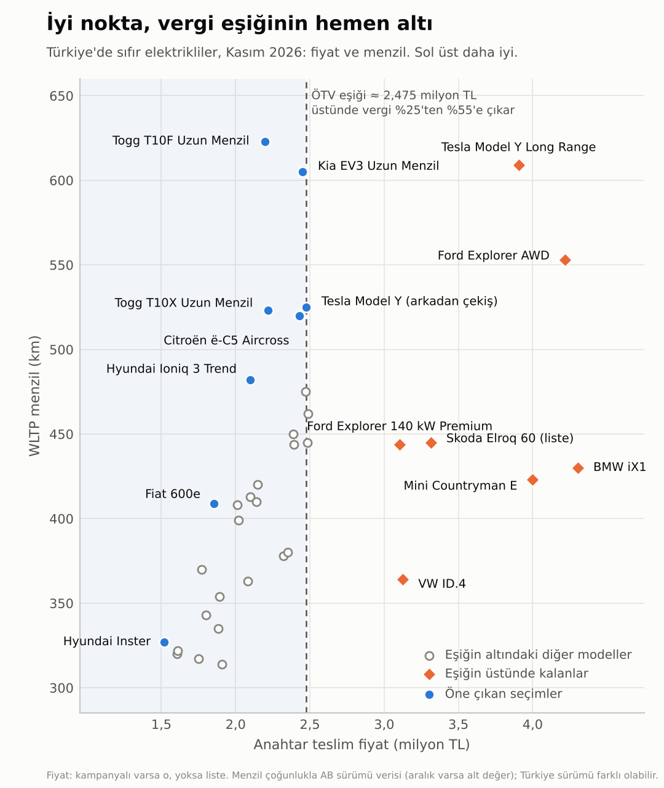

# Türkiye'de elektrikli otomobiller: en premium olanlar ve fiyatına göre en iyiler

22 Kasım 2026. Fiyatlar Kasım 2026 anahtar teslim liste fiyatıdır; kampanya varsa ayrıca yazıldı.

## Kısa yanıt

- **En premium:** Sınıf olarak zirve Rolls-Royce Spectre, ancak Türkiye fiyatı doğrulanamadı. Fiyatı doğrulananlarda sıra: Porsche Taycan (31,2 milyon TL'ye kadar), Porsche Cayenne Electric (21,1), Audi e-tron GT (17,4), Mercedes G 580 (15,7), BMW i7 (14,9), Porsche Macan Electric (12,3), Mercedes EQS (11,8), BMW iX (11,6).
- **Fiyatına göre en iyi:** Togg T10F V1 Uzun Menzil (2.195.600 TL, 623 km). Sonra Kia EV3 Cool Uzun Menzil, Togg T10X V1 Uzun Menzil, Hyundai Ioniq 3 Trend ve Tesla Model Y arkadan çekiş.
- **Neden:** Motoru 160 kW'ı geçmeyen elektriklilerde vergi, yaklaşık 2,48 milyon TL'lik fiyatın üstünde %25'ten %55'e çıkıyor; sıçrama yaklaşık 600 bin TL. İyi nokta bu eşiğin hemen altı.
- **Küçük bütçe:** Fiyatı doğrulanabilen en ucuz elektrikli Hyundai Inster (kampanyalı 1.520.000 TL). Fiat 600e 1.854.900 TL'ye 409 km menzil veriyor.
- Teknik verilerin çoğu Avrupa sürümünden; almadan önce fiyatı ve Türkiye sürümünün değerlerini bayiden teyit et.

## Ne yapmalıyım

1. **Bütçeni eşiğe göre kur.** 2,2–2,5 milyon TL ayırabiliyorsan en çok şeyi bu bantta alırsın. Eşiği geçen 160 kW altı araç en az 3,07 milyon TL oluyor; aradaki farkın çoğu vergi.
2. **İhtiyaca göre seç:**
   - Uzun yol ve en çok menzil: Togg T10F V1 Uzun Menzil ya da Kia EV3 Cool Uzun Menzil.
   - Aile SUV'u: Togg T10X V1 Uzun Menzil ya da Tesla Model Y arkadan çekiş. Citroën ë-C5 Aircross Plus da güçlü aday, ama fiyatı tek kaynaktan; bayiden teyit et.
   - Şehir içi ya da ikinci araç: Hyundai Inster; daha fazla menzil için Hyundai Ioniq 3 Trend ya da Fiat 600e.
   - Premium marka şartsa: Volvo EX30 (2.472.390 TL), eşiğin altında kalan az sayıdaki premium markalı seçenekten biri.
3. **Togg'da uzun menzili al.** T10F'te 310.620 TL farkla menzil 335 km'den 623 km'ye çıkıyor.
4. **Fiyatı teslime kadar sabitlet.** Eşiğe dayalı araçlarda küçük bir zam ya da vergi değişikliği fiyatı yaklaşık 600 bin TL artırabilir. Anahtar teslim fiyatın teslime kadar geçerli olduğunu, teslim tarihini ve kampanya bitiş tarihini yazılı al. Skoda Elroq kampanyası 30 Kasım'da bitiyor; Tesla'nın teslim tarihi doğrulanamadı.
5. **Türkiye sürümünün menzilini, gücünü ve şarj süresini sor.**
6. **Vergi için beklemeye somut bir neden yok.** 2027 başı için duyurulmuş bir eşik ya da oran değişikliği bulunamadı. Eşik Cumhurbaşkanı Kararıyla değiştiği için her iki yönde de sürpriz olabilir.

## 1. En premium elektrikliler

Ölçüt marka konumu ve fiyat; hız ya da menzil sıralaması değil.

**Zirvede, ama fiyatı doğrulanamayanlar:**

- **Rolls-Royce Spectre.** Sınıfça en üstteki elektrikli. Türkiye'de satıldığı bir basın haberine dayanıyor; resmi fiyat yok, basın tahmini 24–30 milyon TL. Black Badge versiyonu 485 kW, yaklaşık 102 kWh batarya, 530 km menzil.
- **Maserati GranTurismo Folgore.** Basına göre Ekim 2026'da Türkiye'ye geldi; yaklaşık 15 milyon TL deniyor, doğrulanamadı.

**Fiyatı doğrulananlar** (premium markalar, en üst versiyonun fiyatına göre sıralı; en üst versiyonu 6,8 milyon TL'nin altında kalanlar alınmadı):

| # | Model | Türkiye fiyatı (milyon TL) | En üst versiyon | Not |
|---|---|---|---|---|
| 1 | Porsche Taycan | 15,74 – 31,23 | Turbo GT: 760 kW, 97 kWh | Şubat 2026 listesi |
| 2 | Porsche Cayenne Electric | 14,03 – 21,11 | Turbo: 850 kW, 113 kWh, 623 km | Teslimatın başladığı doğrulanmadı |
| 3 | Audi e-tron GT ailesi | 12,14 – 17,41 | RS e-tron GT performance: 680 kW, 97 kWh | |
| 4 | Mercedes G 580 | 15,72 | 432 kW, 116 kWh, 434–473 km | Tek versiyon |
| 5 | BMW i7 | 14,36 – 14,89 | M70: 500 kW, 112,4 kWh, 601–686 km | M70 yaklaşık 16 milyon TL deniyor, Kasım listesinde yok; doğruysa 4. sıra |
| 6 | Porsche Macan Electric | 8,71 – 12,28 | Turbo | |
| 7 | Mercedes EQS 500 4MATIC | 11,85 | 350 kW, 122 kWh, 731–869 km | Listedeki tek EQS |
| 8 | BMW iX | 10,89 – 11,63 | M70: 485 kW, 521–600 km | |
| 9 | Audi A6 e-tron | 8,16 – 10,06 | | |
| 10 | Audi Q6 e-tron | 9,34 – 9,58 | | |
| 11 | BMW i5 | 7,92 – 8,13 | | M60 fiyatı doğrulanamadı |
| 12 | Mercedes EQE | 6,29 – 7,19 | EQE 350 4MATIC | |
| 13 | Volvo ES90 | 7,03 | 500 kW | Ekim 2026 lansmanı |
| 14 | BMW iX3 (yeni nesil) | 6,82 | 345 kW, 679–805 km | |

kW motor gücü, kWh batarya kapasitesi, km ise WLTP menzilidir (WLTP: Avrupa'nın standart menzil testi). Güç değerleri kısa süreli en yüksek güçtür; sürekli güç daha düşüktür.

Karakter olarak ayırmak gerekirse: arka koltuk konforu ve sessizlik için Spectre, i7 ve EQS; performans için Taycan ve RS e-tron GT; gösterişli arazi aracı için G 580.

Premium marka olmayan, ama aynı fiyat bandındaki üst sınıf araçlar: Kia EV9 (6,54 – 7,87 milyon TL, 7 koltuklu) ve Hyundai Ioniq 9 (6,04 – 7,30 milyon TL).

**Listeye alamadıklarım** (Türkiye'de satışı ya da fiyatı doğrulanamadı):

- Mercedes-Maybach EQS 680 SUV, EQS SUV ve EQE SUV: Mercedes'in Kasım listesinde yok.
- Maserati Grecale Folgore: kaynaklarda 6,4 ile 9,25 milyon TL arasında çelişkili.
- Lotus Eletre ve Emeya: Türkiye'de resmi satış kanıtı bulunamadı.
- Range Rover Electric ve Ferrari'nin elektriklisi: Türkiye'de satışta değil.
- Volvo EX90: Kasım listesinde yok. Lexus RZ: güncel fiyat yok.
- Tesla Model S ve Model X: Türkiye'de resmi olarak hiç satılmadı.

## 2. Fiyatına göre en iyiler

### İyi noktayı vergi eşiği belirliyor

ÖTV (özel tüketim vergisi) elektriklilerde iki şeye bakıyor: motor gücü ve matrah, yani verginin hesaplandığı vergisiz fiyat.

| Motor gücü | Matrah 1.650.000 TL'ye kadar | Üstü |
|---|---|---|
| 160 kW'ı geçmeyen | %25 | %55 |
| 160 kW'ı geçen | %65 | %75 |

Hesap: 1.650.000 TL matrah, %25 ÖTV ve %20 KDV ile yaklaşık 2.475.000 TL eder. Matrah 1 TL artarsa tüm tutar %55'ten vergilenir ve fiyat yaklaşık 3.069.000 TL olur; yani sıçrama yaklaşık 594 bin TL. Listelerde eşik altı araçların fiyatı 2,49 milyon TL'ye kadar çıkıyor; aradaki küçük farkın nedeni doğrulanmadı. Üreticiler versiyonlarını bu eşiğin hemen altına diziyor:

- Tesla Model Y arkadan çekiş 2.474.985 TL; hesaplanan eşiğin 15 TL altında.
- 140 kW motorlu Ford Explorer'ın Select donanımı 2.391.300 TL, Premium donanımı 3.104.800 TL. Kaba hesapla iki donanımın vergisiz fiyat farkı yaklaşık 75 bin TL; etiketteki 713.500 TL'lik farkın gerisi vergi dilimi.
- Skoda Elroq 60 liste fiyatıyla 3.314.900 TL; kampanya onu 2.481.600 TL'ye, eşiğin altına indiriyor.

### Sıralama

"km başına TL", fiyatın WLTP menziline bölümüdür; düşük olan daha iyi. Tek ölçüt değildir, ama bataryaya ne ödediğini iyi gösterir. Gerçek kullanımda, özellikle otoyolda ve kışın, menzil WLTP değerinin altında kalır. "Eli yüzü düzgün" şartı için bilinen marka, Euro NCAP (Avrupa'nın bağımsız çarpışma testi) sonucu ve garantiye baktım. Farklı büyüklükteki araçları karıştırmamak için iki tablo var.

**Aile sınıfı (orta boy sedan ve SUV):**

| # | Model ve versiyon | Fiyat (TL) | WLTP (km) | km başına TL | Net batarya | Güç | Hızlı şarj (tepe) | Euro NCAP |
|---|---|---|---|---|---|---|---|---|
| 1 | Togg T10F V1 Uzun Menzil | 2.195.600 | 623 | 3.524 | 85 kWh | 160 kW | 180 kW | 5 yıldız |
| 2 | Kia EV3 Cool Uzun Menzil | 2.450.000 | 605 | 4.050 | 78 kWh | 150 kW | 128 kW | 4 yıldız (güvenlik paketiyle 5) |
| 3 | Togg T10X V1 Uzun Menzil | 2.219.668 | 523 | 4.244 | 85 kWh | 160 kW | 180 kW | 5 yıldız |
| 4 | Citroën ë-C5 Aircross Plus | 2.430.000 | 520 | 4.673 | 73 kWh | 157 kW | 160 kW | Doğrulanmadı |
| 5 | Tesla Model Y arkadan çekiş | 2.474.985 | yaklaşık 525 | 4.714 | yaklaşık 60 kWh | yaklaşık 159 kW | 175 kW | 5 yıldız (2025) |

**Kompakt ve küçük sınıf:**

| # | Model ve versiyon | Fiyat (TL) | WLTP (km) | km başına TL | Net batarya | Güç | Hızlı şarj (tepe) | Euro NCAP |
|---|---|---|---|---|---|---|---|---|
| 1 | Hyundai Ioniq 3 Trend | 2.099.000 | 482 | 4.355 | yaklaşık 58 kWh | 99,5 kW | yaklaşık 119 kW | Henüz sonuç yok |
| 2 | Fiat 600e La Prima | 1.854.900 (liste 1.989.900) | 409 | 4.535 | 51 kWh | 115 kW | 100 kW | Sonuç bulunamadı |
| 3 | Hyundai Inster Dynamic | 1.520.000 (liste 1.670.000) | 327 | 4.648 | 39 kWh | 71 kW | 73 kW | 4 yıldız |
| 4 | Kia EV2 Elegance Uzun Menzil | 2.099.000 (liste 2.199.000) | 413–453 | 4.634 – 5.082 | 58 kWh | 99,5 kW | 115 kW | Sonuç bulunamadı |

Hızlı şarj sütunu, aracın doğru akım (DC) istasyonunda alabildiği en yüksek güçtür; şarj boyunca ortalama güç daha düşük olur. Örneğin standart menzilli Togg T10X'te 180 kW tepe değere karşılık yüzde 10'dan 80'e ortalama 70 kW ölçülmüş. Karşılaştırırken tepe güç yerine yüzde 10'dan 80'e şarj süresini sor.

**Neden bu sıra:**

- **Togg T10F V1 Uzun Menzil.** Listedeki en düşük km başına maliyet, en uzun menzil ve 5 yıldız. Garanti araçta 3 yıl ya da 100 bin km, bataryada 8 yıl ya da 160 bin km. Ocak–Ekim 2026'da 18.108 adetle en çok satan ikinci elektrikli. Daha donanımlı V2 Uzun Menzil 2.370.930 TL ve o da eşiğin altında. Zayıf yanı: kullanıcı şikâyetlerinde klima arızası, parça bekleme ve yazılım sorunları geçiyor (kullanıcı beyanı, doğrulanmadı).
- **Kia EV3 Cool Uzun Menzil.** 605 km menzil eşiğin altında kalan fiyata geliyor. Garanti yasal 2 yıl; Kia'nın "Özel Garanti" paketiyle 5 yıl ya da 150 bin km. Üst donanımları (3.199.000 TL ve üstü) eşiği aştığı için aynı değeri vermiyor.
- **Togg T10X V1 Uzun Menzil.** T10F'in SUV gövdelisi; aynı batarya, 523 km. 26.079 adetle 2026'nın en çok satan elektriklisi.
- **Citroën ë-C5 Aircross Plus.** Bu fiyata büyük SUV gövdesi ve 520 km menzil. Fiyatı tek kaynaktan, çarpışma testi sonucu doğrulanmadı; önerim teyit şartına bağlı.
- **Tesla Model Y arkadan çekiş.** Fiyatı tam eşiğe oturtulmuş, Euro NCAP 5 yıldız. Menzil ve batarya değerleri Avrupa sürümünden; 159 kW güç değeri tek kaynaktan. Satışı 2025'teki 31.509 adetten 2026'nın ilk on ayında 6.118'e düştü, Ekim'de yalnızca 25 adet satıldı. Teslim süresini ve fiyat garantisini almadan sipariş verme.
- **Hyundai Ioniq 3 Trend.** İzmit'te üretiliyor, Ekim 2026'da satışa çıktı. 2,1 milyon TL'ye 482 km veriyor. Garanti 5 yıl, bataryada 8 yıl ya da 160 bin km. Yeni model olduğu için çarpışma testi sonucu ve uzun dönem deneyimi yok.
- **Fiat 600e La Prima.** 2 milyon TL altında menzil başına en ucuz araç. Fiyat kampanyalı; çarpışma testi sonucu bulunamadı.
- **Hyundai Inster Dynamic.** Fiyatı doğrulanabilen en ucuz elektrikli. Şehir içi için yeterli; hızlı şarjı 73 kW ile yavaş, menzili 327 km, Euro NCAP 4 yıldız.
- **Kia EV2 Elegance Uzun Menzil.** Ioniq 3 Trend ile aynı fiyat ve benzer batarya. Menzili janta göre 413 ile 453 km arasında değişiyor; hangi değerin Türkiye sürümüne ait olduğu doğrulanmadı.

### Duruma göre iyi olanlar

| Model ve versiyon | Fiyat (TL) | Öne çıkan yanı |
|---|---|---|
| Kia EV2 Cool | 1.749.000 (liste 1.819.000) | 107,8 kW ile bu fiyatın en güçlüsü; 317 km |
| Hyundai Ioniq 3 Select | 1.799.000 | Yerli üretim, 107,8 kW, 343 km |
| Renault Megane E-Tech Techno EV60 | 2.386.000 | 160 kW, yaklaşık 450 km |
| Volvo EX30 Ultra uzun menzil | 2.472.390 | Premium marka; 150 kW, yaklaşık 475 km (Avrupa verisi) |
| Skoda Elroq 60 e-Prestige | 2.481.600 (30 Kasım'a kadar; liste 3.314.900) | 445 km; kampanya biterse değerini yitirir |
| KGM Torres EVX | 2.487.420 | 462 km; 2026'nın en çok satan üçüncü elektriklisi |
| Togg T10X ve T10F 4More | 3.217.937 – 3.218.137 | Çift motor, 320 kW; hızlanma fiyatına göre çok güçlü |

### Fiyatına göre zayıf kalanlar

- **Eşiğin üstündeki küçük premium SUV'lar:** Mini Countryman E 3.999.900 TL (423–462 km), BMW iX1 4.304.800 TL (430–475 km), Volvo EX40 4.609.229 TL, Mercedes EQA 4.612.000 TL, Audi Q4 e-tron 4.832.664 TL. Menzili bilinenler eşiğin altındaki araçlardan fazlasını vermiyor; fark marka ve vergi.
- **VW ID.4 125 kW:** 3.126.000 TL'ye 364 km; km başına 8.588 TL.
- **Togg standart menzil versiyonları:** T10X 1.909.048 TL, 314 km. Uzun menzil farkı küçük, kazancı büyük.
- **Tesla Model Y Long Range arkadan çekiş:** 3.906.000 TL, 609 km. Giriş versiyonundan 1,43 milyon TL pahalı.

## 3. Pazarın durumu

- Ocak–Ekim 2026'da 135.142 tam elektrikli otomobil satıldı. İlk üç: Togg T10X (26.079), Togg T10F (18.108), KGM Torres EVX (12.159). 2025'in lideri Tesla Model Y belirgin geriledi.
- Kasım 2025'ten beri Avrupa Birliği ve serbest ticaret anlaşmalı ülkeler dışından gelen elektriklilere %30 ya da en az 8.500 dolar ek yük uygulanıyor.
- MG, Toyota, Suzuki, Nissan ve Honda'nın Kasım listelerinde elektrikli otomobil yok. Nedenini doğrulayamadım; ek yük olası açıklama.
- BYD'nin listesinde yalnızca Seal (4.077.000 TL, kampanyalı 3.772.000 TL) ve Tang (5.418.000 TL) fiyatlı. Dolphin, Atto 2, Atto 3, Seal U ve Sealion 7 fiyatsız duruyor. Basına göre Manisa fabrikası yatırımı askıda ve üretim başlamadı.
- Sonuç: bugün fiyat/performans listesini Türkiye, Avrupa Birliği ve Kore üretimi araçlar dolduruyor.

## 4. Emin olunmayanlar ve doğrulama kapsamı

**Doğrulama kapsamı.** Sonucun dayandığı 57 satır ikinci bir ajanla yeniden kontrol edildi: 32'si doğru çıktı, 17'si düzeltildi, 8'i doğrulanamadı. Ardından bir eleştirmen taslağa itiraz etti; premium sıralaması, vergi anlatımı ve şarj sütunu buna göre düzeltildi. Düzeltilenlerin başlıcaları:

- Porsche fiyatları eski listedendi (Taycan Turbo GT 26,6 değil 31,2 milyon TL).
- Mercedes EQS'in satılan versiyonu 450 değil 500 4MATIC.
- Ford Explorer'ın ucuz fiyatları Premium değil Select donanımına ait.
- Hyundai Inster'ın hızlı şarj gücü 120 değil 73 kW.
- Togg T10F standart menzil 314 değil 335 km.
- Tesla Model Y'nin Euro NCAP sonucu 5 yıldız (taslakta "doğrulanmadı" yazıyordu).

**Emin olunmayanlar:**

- Fiyatların çoğu fiyat ve haber sitelerinin Kasım 2026 listelerinden. Resmi sayfadan okunabilenler: Kia, Hyundai, BYD ve Porsche. Tesla, Ford, Fiat, Citroën, Opel, Renault ve Volvo siteleri otomatik erişimi engelledi.
- Menzil, net batarya ve hızlı şarj değerlerinin çoğu Avrupa sürümüne ait.
- ÖTV eşiği üç ikincil kaynakta tutarlı (10115 sayılı Karar, 24 Temmuz 2025), ancak Resmi Gazete tablosu doğrudan okunamadı. 2026'da değişiklik bulunamadı; olmadığı kanıtlanmış değil.
- Rolls-Royce Spectre'ın Türkiye satışı tek habere dayanıyor, fiyatı tahmin. BMW i7 M70 ve i5 M60 fiyatları Kasım listesinde yok.
- Tesla Model Y'nin Türkiye'deki gücü (159 kW) tek kaynaktan; teslim tarihi doğrulanamadı.
- ë-C5 Aircross, Megane E-Tech ve Renault 5 fiyatları tek kaynaktan.
- MG4 için "1.369.000 TL'den başlayan" bir bayi kampanyası haberi var; doğrulanamadı, listeye alınmadı. Doğruysa en ucuz elektrikli o olur.
- Servis ağı genişliği ve ikinci el değeri bu raporda incelenmedi.

## 5. Kaynaklar

Fiyat listeleri (Kasım 2026):

- Toplu liste: https://www.donanimhaber.com/elektrikli-araba-fiyatlari--159687
- Togg: https://www.milligazete.com.tr/togg-kasim-2026-fiyat-listesi-belli-oldu-t10x-ve-t10f-kac-tl-faizsiz-kredi-kampanyasi-ne-kadar
- Tesla: https://webtekno.com/tesla-kasim-2026-fiyat-listesi-h228466.html
- Kia: https://www.kia.com/tr/modeller/ev2/fiyat-listesi.html
- Hyundai: https://www.webtekno.com/hyundai-kasim-2026-fiyat-listesi-h228271.html
- Hyundai Ioniq 3: https://www.cnbce.com/otomotiv/hyundai-ioniq-3-turkiye-fiyatlari-482-km-menzil-2027de-odeme-imkani-g39791
- Citroën: https://www.webtekno.com/kasim-2026-citroen-fiyat-listesi-h228205.html
- Fiat: https://webtekno.com/kasim-2026-fiat-fiyat-listesi-h228142.html
- Renault: https://www.webtekno.com/renault-kasim-2026-fiyat-listesi-h228073.html
- Volvo: https://www.webtekno.com/volvo-kasim-2026-fiyat-listesi-h228322.html
- BMW: https://www.webtekno.com/bmw-kasim-2026-fiyat-listesi-h228074.html
- Mini: https://webtekno.com/mini-2026-fiyat-listesi-h228388.html
- Audi: https://www.webtekno.com/kasim-2026-audi-fiyat-listesi-h228118.html
- Mercedes: https://www.webtekno.com/mercedes-benz-kasim-2026-fiyat-listesi-h228664.html
- BYD: https://www.bydauto.com.tr/fiyat-listesi
- Porsche: https://configurator.porsche.com/tr-TR/mode/model/Y1AFT1
- Rolls-Royce haberi: https://tr.motor1.com/news/780647/rr-spectre-black-badge-turkiyede/

Vergi ve satış:

- ÖTV kararı: https://www.alomaliye.com/2025/07/24/4760-sayili-otv-ekli-ii-sayili-liste-otv-oranlari-karar-sayisi-10115/
- Gümrük kararı: https://www.karar.com/ekonomi-haberleri/ithal-otomobilde-yeni-gumruk-vergisi-donemi-1993499
- Satış, Ocak–Ekim 2026: https://www.tamindir.com/haber/turkiye-ekim-2026-en-cok-satilan-elektrikli-arabalar_112609/
- Satış, 2025: https://www.webtekno.com/2025-turkiye-en-cok-satilan-elektrikli-otomobiller-h210273.html
- BYD yatırımı: https://www.donanimhaber.com/takvim-isliyor-byd-ye-saglanan-devlet-destekleri-iptal-edilecek--208190

Teknik veri ve güvenlik:

- https://ev-database.org
- Tesla Model Y Euro NCAP: https://www.euroncap.com/en/results/tesla/model+y/57985

Satır bazında kaynaklar `ek/` klasöründeki defterlerde.

## 6. Devam notu

- Bulgu: sınıfça en premium elektrikli Rolls-Royce Spectre, fiyatı doğrulananlarda Porsche Taycan; fiyatına göre en iyi Togg T10F V1 Uzun Menzil, ardından Kia EV3 ve Togg T10X.
- Ana açıklama: 160 kW altı araçlarda yaklaşık 2,48 milyon TL'lik ÖTV eşiği; iyi seçimler bu eşiğin hemen altında.
- Dosyalar: `RAPOR.md` (bu dosya), `fiyat_menzil.png` (grafik), `ek/` (A–D ve G üretici defterleri, V1–V3 doğrulama tabloları).
- Açık kalanlar: Türkiye sürümlerinin teknik verileri, Tesla teslim süresi, Rolls-Royce, Maybach, Lotus ve Maserati'nin satış ve fiyat durumu, servis ağı ve ikinci el değeri.
- Fiyatlar aylık değişiyor; Aralık 2026 listeleri çıkınca ya da vergi eşiği güncellenirse tablo yenilenmeli.

Maliyet: Seviye M · 5 üretici (sonnet) + 3 doğrulayıcı (sonnet) + 1 eleştirmen (opus) + 1 sayfa okuyucu (haiku) · 2 üretim dalgası · kontrol noktasını geçenler: giriş sınıfı üreticisi (36/35, fiyat çelişkisi) ve üç doğrulayıcı (50/40, 62/40, 60/34; satırların çoğunda çelişki ve eksik teknik veri vardı) · aşılan sınır yok.
